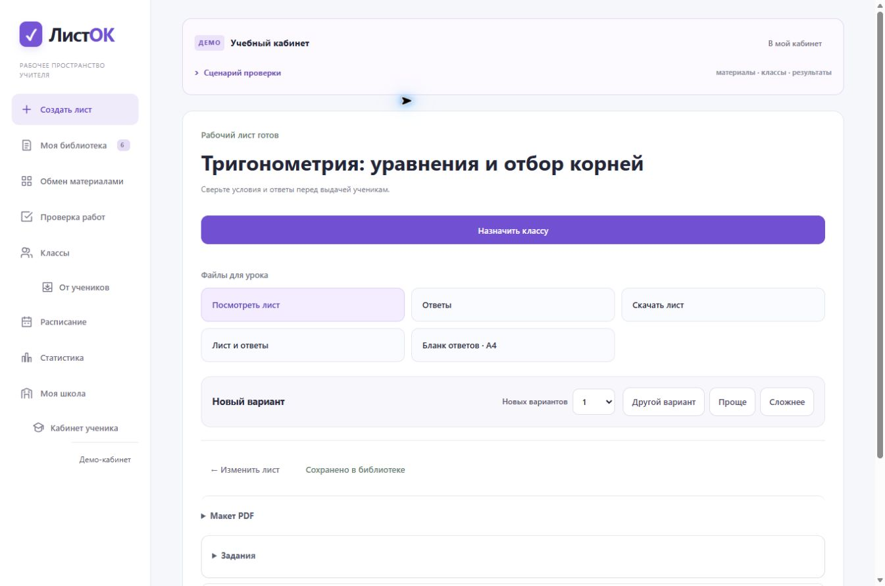
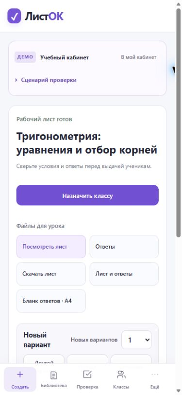
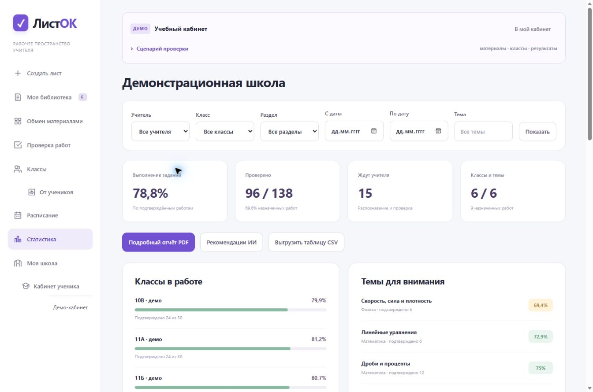

# ЛистОК

**Команда «ЛатехТим» · хакатон «Идея фикс» · Арсенал мастера**

Капитан — **Николай Семченков**. Участники: **Максим Скоков, Дмитрий Мазка,
Таисия Алексинская, Анастасия Почкина**. Сборка и публикация — через GitHub `pavelneumoin`.

## От задания до результатов класса

ЛистОК помогает учителю подготовить рабочий лист, распечатать его, назначить
классу и проверить собранные ответы. Ученик может отправить свою работу с телефона,
а завуч — посмотреть подтверждённые результаты школы.

[Открыть бота в MAX](https://max.ru/ideya_fiks_126_bot) ·
[Открыть кабинет](https://listok.84.201.135.165.sslip.io) ·
[Скачать Docker-образ](https://github.com/pavelneumoin/worksheet-creator/releases) ·
[Документация проекта PDF](docs/project/listok-project.pdf)

**[Видеоинструкция — 5:48](docs/VIDEO_GUIDE.md)** ·
[Текст для озвучки](docs/VIDEO_NARRATION.md). Весь путь учителя, ученика и завуча
на экранах учебного кабинета.

**Попробовать без подготовки:** войдите через `/start` в MAX и нажмите
**«Посмотреть демо»**. Там уже есть листы, классы, проверки и школа.
Учебные данные отделены от вашего рабочего кабинета. [Маршрут демо](docs/DEMO.md).



## Как проходит урок

1. **Подготовьте материал.** Загрузите фото учебника, PDF или текст. Выберите
   оформление, количество столбцов и поле для решения. Обработка идёт в фоне.
2. **Получите комплект.** Лист сохраняется в личную библиотеку. На экране сразу
   доступны PDF, ответы, комплект учителя и отдельный бланк ответов A4.
   Рядом — другой вариант, проще или сложнее.
3. **Назначьте классу.** Выберите класс и дату. Для коротких ответов распечатайте
   персональные бланки с кодами и QR: одна страница на ученика вместо всей работы.
4. **Проверьте.** Загрузите общую пачку PDF или получите работы от учеников.
   Откройте общую очередь сомнений, увеличьте фрагмент и поставьте полный или
   частичный балл. Полные решения тоже можно загрузить и разобрать.
5. **Посмотрите результат.** Подтверждённые баллы попадают в отчёт класса и школы.
   Работу можно вернуть ученику на исправление с комментарием.

| Учитель | Ученик | Завуч |
| --- | --- | --- |
| Материалы, варианты, печать, классы, расписание | Свои задания и PDF, отправка фото или файла | Результаты подключённых учителей |
| Пачка сканов, очередь сомнений, частичные баллы | Баллы по заданиям, замечания, повторная сдача | Фильтры по периоду, классу, теме и разделу |
| Личная библиотека и добровольный обмен | История попыток | Подробные PDF и CSV |

<p align="center"></p>

## Проверка с участием учителя

Распознавание сохраняет нечёткие и пустые ответы как неопределённые. Разбор полного
решения показывает шаг, объяснение и рекомендацию балла; учитель сверяет их со сканом.
Оценки включаются в статистику только после подтверждения. Несданная работа не
считается нулём. Новая попытка ученика не заменяет прежний балл до повторной проверки.

Методические ориентиры по математике опираются на общие принципы материалов ФИПИ.
Это помощь в проверке обычного рабочего листа, а не официальное оценивание ОГЭ/ЕГЭ.
Точность на рукописных работах пока не измерена на репрезентативной выборке.

[Кабинет ученика](docs/STUDENT_PORTAL.md) · [Развёрнутые решения](docs/SOLUTION_REVIEW.md) ·
[Очередь сомнений](docs/BATCH_QUEUE.md)



## Что можно сделать в чате MAX

- Отправить фото и получить рабочий лист без перехода в кабинет.
- `/today` — работы на сегодня и файлы для печати.
- `/check` и `/next` — перейти к проверке и очереди сомнений.
- `/summary` — сводка; `/repeat` — материал для повторения ошибок.
- `/demo` — учебный кабинет с готовыми примерами.

Вход через конкурсного бота работает. Открытие именно во встроенном мини-приложении
MAX требует привязки HTTPS-адреса владельцем бота. Это действие организаторов;
проверку Edge мы не выдаём за проверку на Android/iOS MAX.

В кабинете доступны четыре предмета: **математика, физика, химия и другой
предмет**. Для химии сохраняются формулы веществ и индексы, а режим «Другой
предмет» оставляет места, требующие проверки учителя. В разделе «Отзывы» можно
поставить оценку, описать удобные и сложные места и посмотреть отклики коллег.
При вводе текста задания открывается компактная LaTeX-клавиатура: дроби,
степени, корни, знаки и основные символы вставляются одним нажатием.

## Документация

| Документ | Что внутри |
| --- | --- |
| [Проектная работа, PDF](docs/project/listok-project.pdf) / [LaTeX](docs/project/listok-project.tex) | Цель, задачи, устройство, инструкции, проверка и развитие |
| [Быстрый запуск](RUN.md) | Сервер, HTTPS, MAX, конфигурация моделей |
| [Соответствие положению](docs/CONTEST_CHECKLIST.md) | Четыре критерия полуфинала и сценарий показа |
| [Демо](docs/DEMO.md) | Сложная математика, физика, классы и синтетические результаты |
| [Классы](docs/CLASSES.md) | Импорт списка, коды учеников и локальная таблица ФИО |
| [Итоги ночного обновления](docs/NIGHT_RELEASE_2026-11-07.md) | Выполненные этапы и приёмка |

## Запуск для разработчика и проверяющего

Нужен Docker Compose. Версии Python-библиотек закреплены в [requirements.txt](requirements.txt).
Секреты не входят в репозиторий или образ. Заполните `.env` по [RUN.md](RUN.md).

```bash
git clone https://github.com/pavelneumoin/worksheet-creator.git
cd worksheet-creator
cp .env.example .env
# Укажите в .env ключ провайдера, токен MAX и адрес своего сервера.
docker build -t listok:night7 .
docker compose up -d --wait
curl --fail http://127.0.0.1:3005/api/health/ready
```

Готовый архив образа находится в **Releases** вместе с SHA256. Он публикуется после
прохождения CI; большой бинарный архив хранится в релизе, исходный Dockerfile — в репозитории.

```bash
sha256sum --check listok-image.sha256
gunzip -c listok-image.tar.gz | docker load
docker compose up -d --wait
```

Для публичного сервера с HTTPS и обработчиком бота:

```bash
docker compose -f compose.yaml -f compose.https.yaml -f compose.bot.yaml up -d --wait
```

На рабочем сервере также используется локальный `compose.storage.yaml` с размещением
данных. Его содержимое относится к конкретному серверу. [Резервное копирование](RUN.md).

### Устройство и проверки

Flask API, отдельные обработчики фоновых задач и LaTeX, SQLite, MAX webhook,
адаптивный интерфейс HTML/CSS/JavaScript. Компилятор изолирован от сети и ключей моделей.
Доступ к файлам проверяется по владельцу, скачиваемые версии связаны с назначением.
Официальный DeepSeek: распознавание изображений и текстовый анализ разделены;
имена моделей и ключ задаются конфигурацией. [Настройка](RUN.md#deepseek).

```bash
python -m unittest discover -s tests -v
node --test tests/*.test.cjs
python scripts/smoke_answer_forms.py
python scripts/smoke_typography.py
python scripts/smoke_analytics.py
python scripts/build_project_docs.py
```

CI дополнительно собирает образ, печатные материалы, проверяет Marp, запускает сервисы
и повторяет проверку после перезапуска. Платные запросы к API выполняются отдельно
только на подготовленных учебных примерах. Для текущего обновления локально прошли
305 Python-тестов и 31 Node-тест; итог CI доступен во вкладке Actions.

Ближайшее развитие: проверка качества на настоящих обезличенных сканах, автоматическое
выравнивание бланков, более точные фрагменты решений, черновик проверки ученических
попыток с автосохранением, уведомления ученику о возврате работы и предметные критерии.
Конкурсную работу подаёт капитан; публикация репозитория не является отправкой заявки.

## Новое: проверка и голосовой запрос

Правки проверки ученических работ сохраняются автоматически. При возврате бот уведомляет ученика в MAX. В чате можно надиктовать тему и пожелания к листу: `/voice`, исправить запрос — `/тема …`, открыть работы ученика — `/my`.

[Как это работает, ограничения и настройка](docs/VOICE_AND_AUTOSAVE.md).
