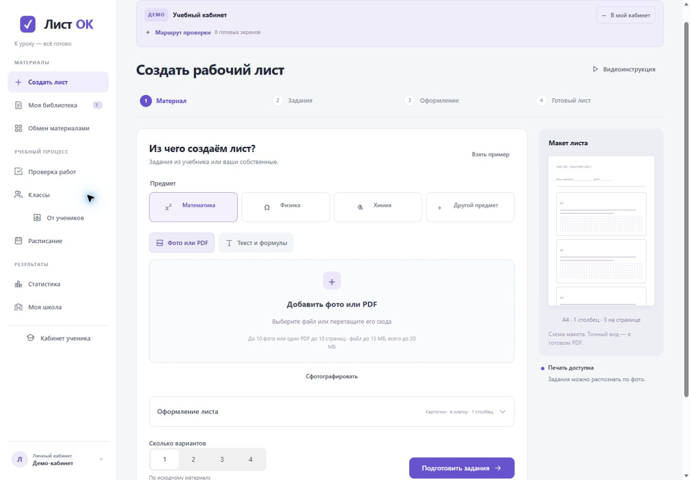
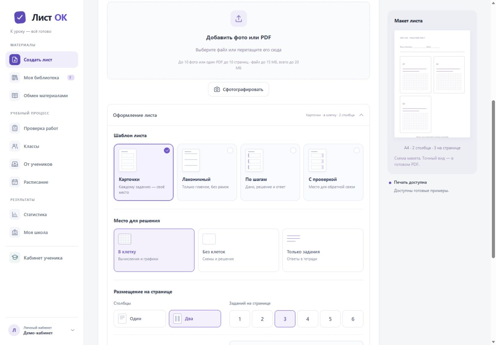
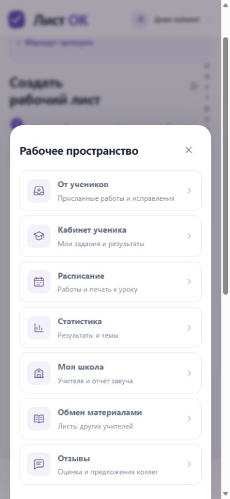
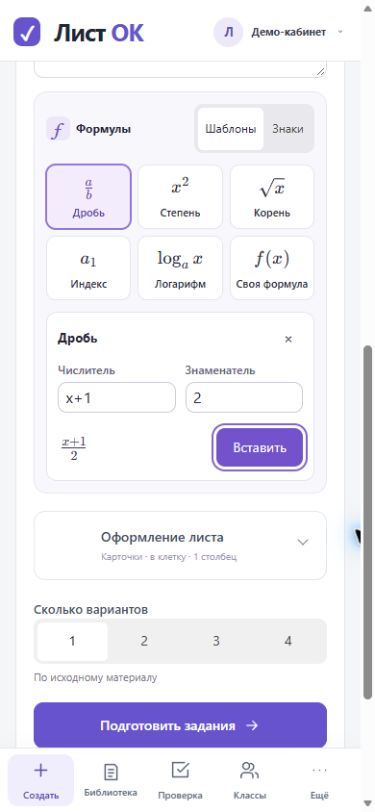
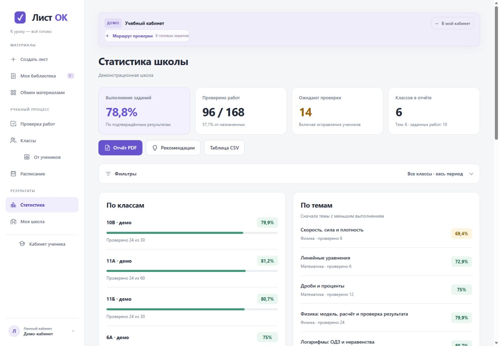

# Обновление интерфейса · 20 ноября 2026

Переработаны создание листа, библиотека, кабинет ученика и отчёты. Основной
путь учителя стал короче: выбрать материал, подготовить задания, открыть файлы
для печати и назначить работу классу.

## Что изменилось

- **Создание листа.** Фото/PDF и текст разделены на вкладки. При переключении
  введённый материал сохраняется; подсказка показывает, что отправится на
  обработку. Настройки и пожелания собраны вместе, количество вариантов
  расположено рядом с основной кнопкой. Пример и видеоинструкция открываются
  по запросу.
- **Файлы и библиотека.** Компактные карточки, короткие статусы и разделённые
  действия. У файлов подписано назначение: лист ученика, ответы учителя,
  комплект с ответами и бланк A4 для быстрой проверки.
- **Общий интерфейс.** Выровнены кнопки и поля, пересмотрены интервалы,
  мобильная навигация и меню профиля. Дополнительные действия закрываются
  клавишей Escape или нажатием вне меню.
- **Ученик и работы от учеников.** Работы группируются по состоянию;
  исправления и несданные задания видны первыми. Показаны баллы, прогресс
  и история попыток. Перед отправкой проверяются формат, количество и размер
  файлов. Учителю доступен список последних попыток по каждой работе.
- **Статистика класса и школы.** Сводные показатели вынесены наверх,
  фильтры сворачиваются, активный отбор виден отдельно. Обновлены представление
  результатов, пустые состояния и действия для выгрузки отчётов.



## Кнопки, значки и настройки материала

Создание листа получило единые настройки на первом и третьем шагах:
четыре наглядных шаблона, выбор поля для решения, столбцов, числа заданий
и высоты поля. Выбранные значения сохраняются при переходах и открытии
материала. При выборе «Только задания» высота поля недоступна.

Значки собраны в локальный SVG-набор с едиными размерами и толщиной линий.
Исправлены пересечения контуров у проверки и школы, исчезновение значка
сохранения после загрузки листа, выделение фильтров ученика и расположение
элементов мобильного меню. Кнопки с одним значком имеют подписи для чтения
с экрана; настройки доступны с клавиатуры.



<p align="center"></p>

Для этой доработки пройдены 54 проверки JavaScript и 5 проверок формул;
осмотрены настройка листа, меню, библиотека, файлы и фильтры ученика в Edge.

## Формулы с Astryx

В математическом редакторе и выборе количества вариантов используются
настоящие компоненты [Astryx](https://github.com/meta/astryx): `Button`,
`TextInput` и `SegmentedControl`. Версии закреплены: Astryx **0.7.16**,
React **19.3.1**.

Дробь, степень, корень, индекс и логарифм собираются из отдельных полей.
Формула сразу отображается в предпросмотре KaTeX и вставляется в выбранное
место текста. Выделенное выражение можно использовать в шаблоне. Существующие
математические разделители не дублируются; ограничение длины задания
сохраняется. Есть отдельная панель знаков и ввод своей формулы LaTeX.

На телефоне шаблоны располагаются в три столбца, без горизонтальной прокрутки
всей панели. Предпросмотр длинной формулы прокручивается внутри своего поля.

<p align="center"></p>

Компоненты подключены к существующему приложению отдельными блоками React.
Их стили ограничены этими блоками; глобальная тема приложения не меняется.
JavaScript и CSS хранятся в репозитории, внешние CDN для Astryx не нужны.



## Что проверено

| Проверка | Результат |
| --- | --- |
| Python | 305 тестов пройдено |
| JavaScript интерфейса | 54 теста пройдено |
| Формулы и вставка в текст | 5 тестов пройдено |
| Сборка компонентов Astryx | `npm run build:ui` выполнена |
| Адаптивный интерфейс в Edge | Проверены ширины 320, 390, 768 и 1440 px |

В браузере осмотрены реальные страницы приложения с учебными данными:
расположение текста, кнопок и карточек, переключатели и редактор формул.
Проверены выбор вариантов, поля дроби и вставка формулы в текст задания.

Эта проверка относится к интерфейсу и локальному демо. Она не заменяет
проверку встроенного браузера MAX на телефоне или полный сценарий с платными
запросами к моделям, распознаванием новых сканов и проверкой рукописных работ.
Учебная статистика синтетическая. Публикация версии на сервере выполняется
отдельным этапом.

## Как изменить и собрать компоненты

Обычный Docker-запуск использует готовые файлы из
`app/frontend/vendor/astryx/`. Устанавливать Node.js в рабочий контейнер
не требуется.

Если меняются `ui/` или `scripts/build_ui.mjs`, в корне репозитория выполните:

```sh
npm ci --ignore-scripts
npm run build:ui
npm run test:ui
```

Вместе с исходниками сохраните обновлённые файлы
`app/frontend/vendor/astryx/`. Подробности подключения и изоляции стилей —
в [описании компонентов](../ui/README.md).
