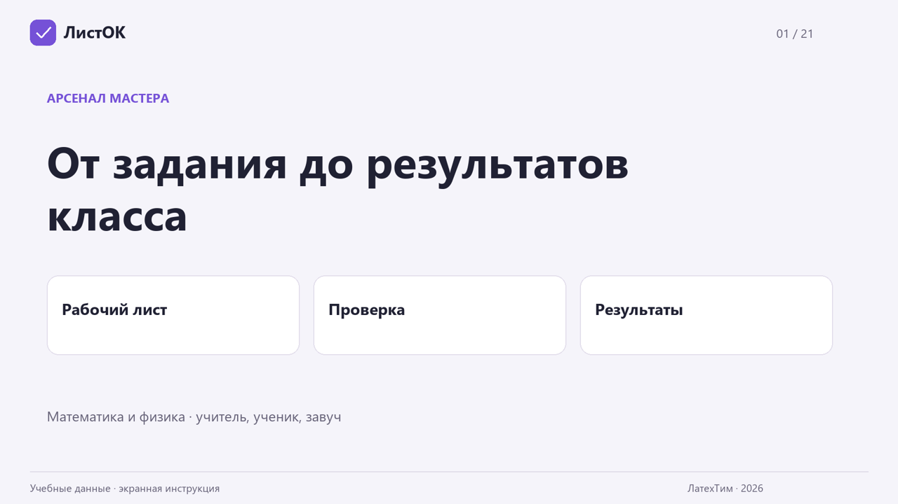

# Видеоинструкция ЛистОК

**5 минут 48 секунд · Full HD · без голоса.** Настоящие экраны учебного кабинета,
крупные подписи и отдельный текст для озвучки.

- [Скачать MP4](https://github.com/pavelneumoin/worksheet-creator/releases/download/listok-2026.11.07-guide2/listok-guide-silent.mp4)
- [Текст с таймкодами](VIDEO_NARRATION.md)
- [Текст для чтения, TXT](https://github.com/pavelneumoin/worksheet-creator/releases/download/listok-2026.11.07-guide2/narration.txt)
- [Комплект для монтажа, ZIP](https://github.com/pavelneumoin/worksheet-creator/releases/download/listok-2026.11.07-guide2/listok-guide-editing-kit.zip)

## Что показано

| Начало | Раздел |
| --- | --- |
| 00:00 | Знакомство и вход через MAX |
| 00:28 | Готовое демо |
| 00:42 | Создание рабочего листа и печать |
| 01:20 | Коды учеников, назначение классу и бланки ответов |
| 02:12 | Пачка PDF, сопоставление страниц и проверка |
| 03:14 | Автосохранение и возврат на исправление |
| 03:48 | Кабинет ученика и повторная сдача |
| 04:22 | Статистика школы и отчёт |
| 04:56 | Быстрый лист и голосовой запрос в чате |

## Как озвучить

Импортируйте MP4 в привычный видеоредактор. Записывайте голос по абзацам из текста,
оставляя паузы между шагами. Если чтение занимает больше времени, используйте
отдельные сцены из папки `clips` в ZIP: каждую можно удлинить последним кадром из
`frames`. Служебную заметку перед текстом первой сцены читать не нужно.

В комплекте 21 фрагмент MP4, 21 крупный кадр, текст и список сцен с длительностью.
Папка `source` содержит снимки экрана и сборщик: скопируйте её содержимое в корень
репозитория, установите Pillow и FFmpeg и запустите
`python scripts/build_video_guide.py`. Ключи и база пользователей для сборки не нужны.

Это смонтированная инструкция по снимкам экрана. Показаны синтетические классы,
работы и результаты. В голосовом разделе показана справка бота; точность на живой
речи пока не измерена. Вход по личной ссылке проверен, встроенный запуск MAX
зависит от привязки мини-приложения организаторами и проверки на телефоне.
